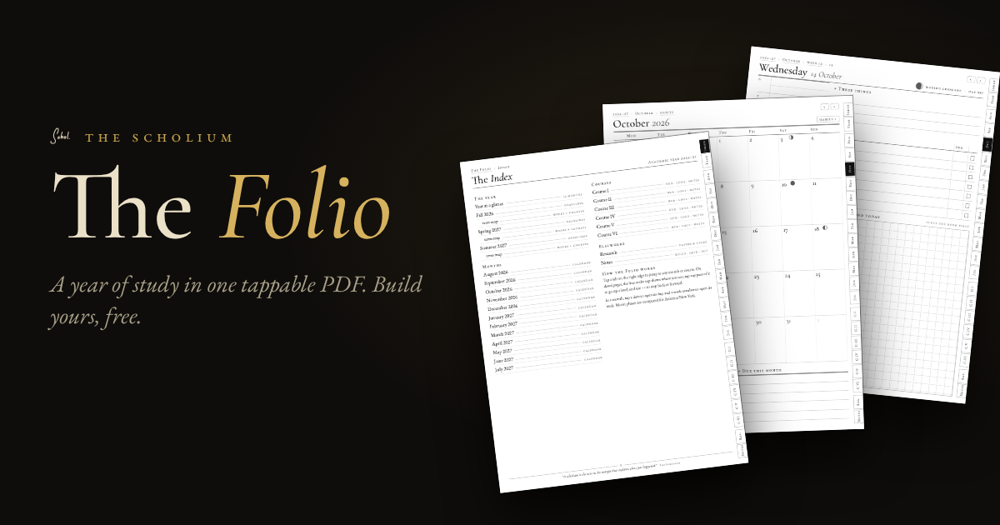
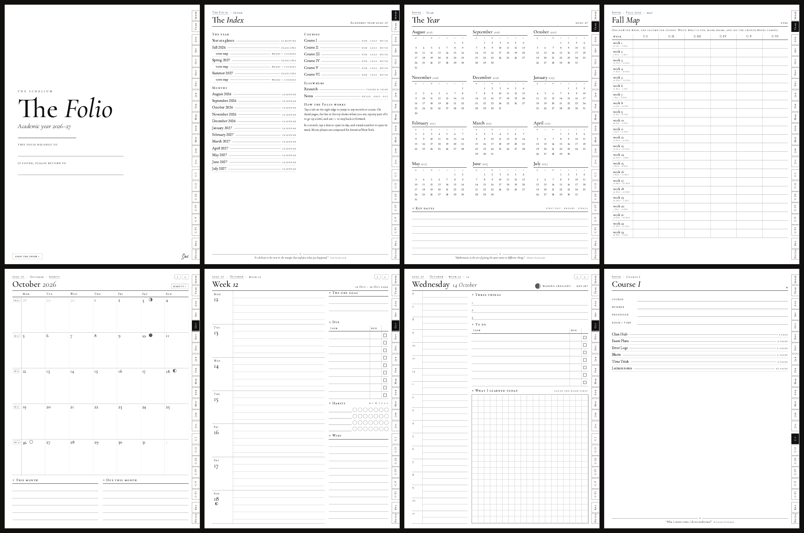

<p align="center"></p>

# The Folio

A whole academic year in one PDF, built for e-ink tablets. Every page has a row of tabs down the right edge: index, year, each month, each of your courses, research and notes. Every date is a link, every week number is a link, and every dated page has a breadcrumb trail and ‹ › arrows. On a Supernote you tap your way around it like an app.

**[Build your own →](https://thescholium.github.io/scholium-folio/)** It runs in your browser. Pick the start month, Sunday or Monday weeks, a page a day or weeks only, and type your courses; their names go on the tabs.



## What's inside

| Section | Pages |
| --- | --- |
| **Cover and index** | The index links to everything. |
| **The year** | Twelve small calendars; every day links to its page. Plus a box for key dates. |
| **Terms** | A deadlines page for each term (copy your syllabi in once), and a **term map**: one row per week, one column per course, so the crunch weeks are visible a month ahead. |
| **Months** | A calendar with week numbers, the moon's phases, goals and due dates, then a habit tracker for the month. |
| **Weeks** | Seven days, one goal, what's due, habit rings, wins. |
| **Days** *(daily edition)* | 6 a.m. to midnight, three things, a to-do list with due dates, and a grid for "what I learned today" — close the book first. |
| **Courses** | For each course: a cover page, a Class Hub, two Exam Plans, four Error Logs, four Blurts, two Time Trials and twelve pages of notes. |
| **Research and notes** | Twelve Research pages for papers and talks; thirty ruled, grid and dot pages. |

The daily edition is about 650 pages and 7 MB; the weekly edition is about 285 pages and 2.4 MB.

## The moon

Each day page shows the moon as it looks that day, and the month calendars mark new moon, first quarter, full moon and last quarter. The phases come from Jean Meeus's *Astronomical Algorithms* (chapter 49) and land within a minute or two of the published times: the generator gives 18:21 UTC for the new moon of the 8 April 2024 eclipse and 06:55 UTC for the full moon of the 14 March 2025 eclipse, which is what the eclipse tables say. You choose the time zone, so a full moon at 1 a.m. lands on the right date for you.

It is decorative. It is also correct.

## On the tablet

1. Build it, in the web builder or with the command line below.
2. Copy the PDF to the **Document** folder on your Supernote with USB, the Partner app or Supernote Cloud.
3. Open it and tap a tab. If your pen draws instead of following the link, tap with a finger.

Every page is 1404 × 1872 px, the Nomad's own resolution, so nothing is scaled. It also fits the reMarkable 2 exactly.

## How it is built

The planner is HTML and CSS, printed to PDF by Chromium. The same generator, [`docs/folio.js`](docs/folio.js), runs in the web builder and in the command-line build here.

```bash
pip install playwright pikepdf pypdf
playwright install chromium
python3 build.py --out my-folio.pdf
python3 build.py --sunday --weekly --start 2027-01 --months 6 \
                 --courses "Quantum Mechanics:QM,Real Analysis:Analysis" --out spring.pdf
./make_all.sh          # the four standard editions, each one audited
```

A few things make it work well on e-ink:

- **Vector paper.** Chromium turns CSS gradients into bitmaps when it prints, which makes soft lines and big files. Ruled, grid and dot paper are drawn as SVG paths instead.
- **Plain links.** `postprocess.py` rewrites every link as a direct page reference, which every PDF reader understands, and stores the template images in grayscale.
- **Checked links.** `audit.py` follows every link (about 18,000 in the daily edition) and confirms it lands on the right page.
- **Two implementations.** [`reference/build_folio.py`](reference/build_folio.py) is the original Python generator. `parity.py` builds the same planners both ways and checks that every page, every link, every moon phase and every week match.

## License

The pages: [CC BY-NC-SA 4.0](LICENSES/CC-BY-NC-SA-4.0.txt), like the [templates](https://github.com/TheScholium/scholium). Print it, share it, adapt it; don't sell it. The code: [MIT](LICENSES/MIT.txt). Fonts: EB Garamond and Cormorant Garamond, [SIL Open Font License](LICENSES/OFL-1.1.txt).
